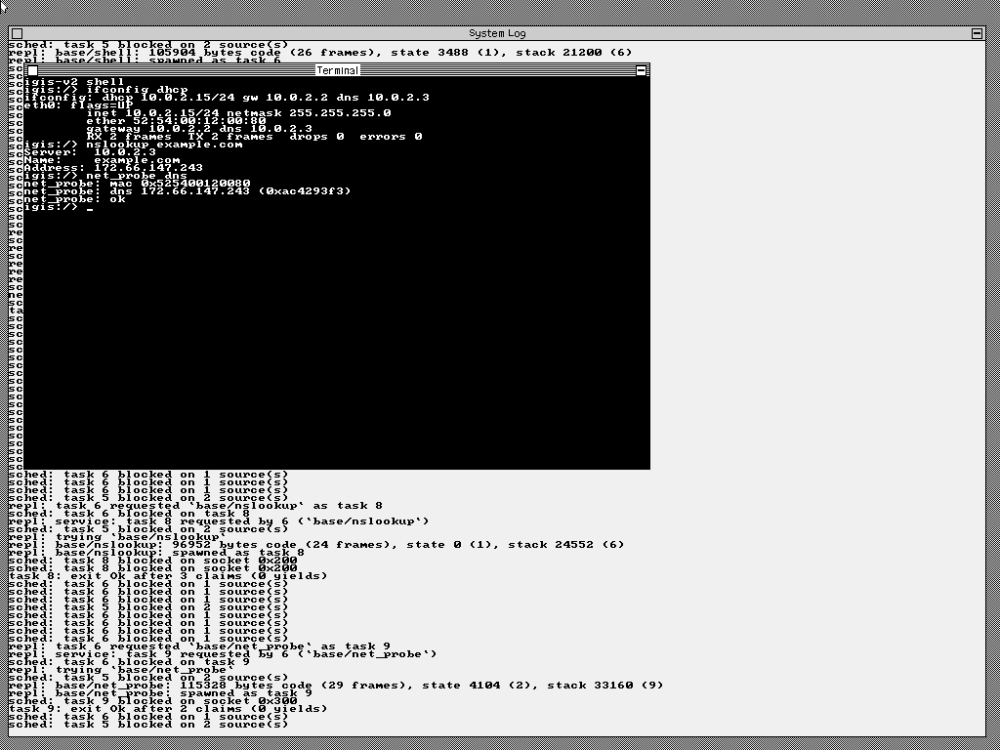
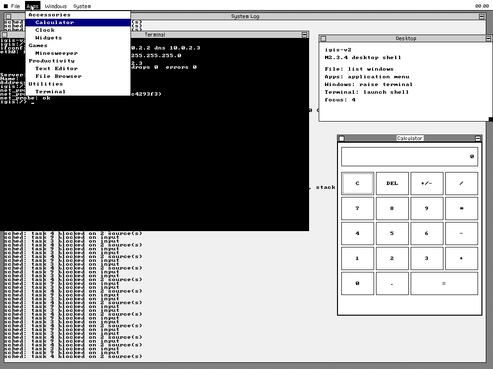
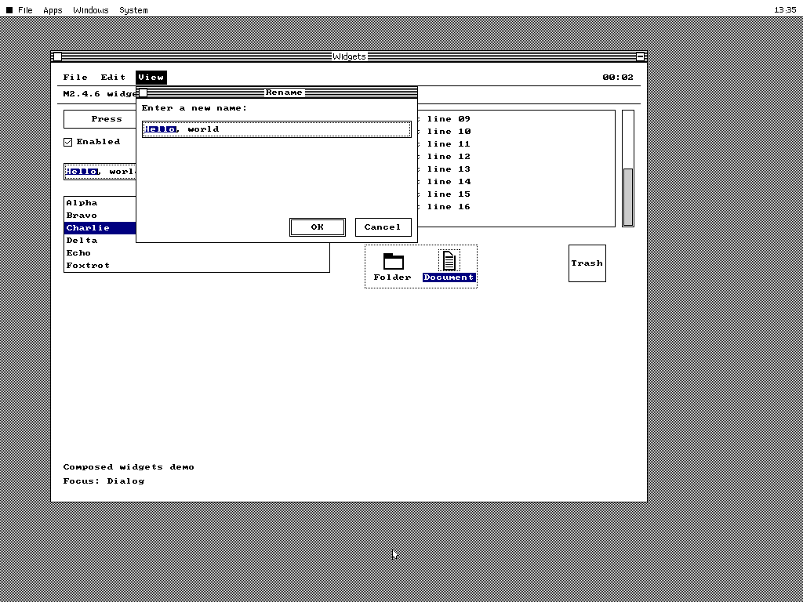
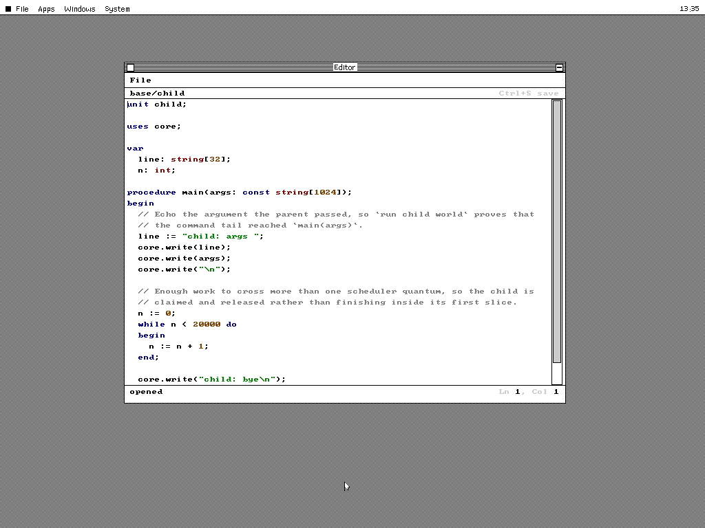
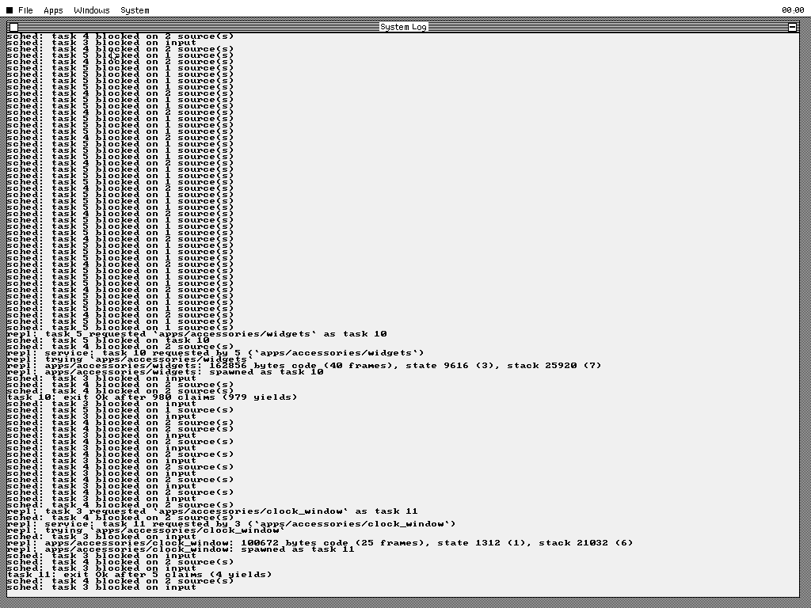

# igis-v2

A second-generation, from-scratch operating system written in Rust. The first version
(2005) was a bare-metal front-end for a modem; the second is a
general personal system built on the same thesis: the kernel is a language runtime that
owns the machine, applications are source text compiled in the kernel, and everything runs
at ring 0 in one address space.


*Real QEMU framebuffer. The terminal is running `ifconfig dhcp`, `nslookup example.com`
and `net_probe dns`; Calculator is an ordinary source application, and the Desktop panel
belongs to the interpreted desktop shell.*

## Screenshots

These are unedited 1024×768 QEMU framebuffer captures, not mockups. The harnesses in
[`scripts/`](scripts/) reproduce them on a headless boot.

| Networking | Apps |
|---|---|
|  |  |

| Widgets | Editor |
|---|---|
|  |  |

| File Browser | Clock |
|---|---|
|  |  |

## Releases

Pushing a tag builds the kernel, the ext2 application volume and the `/home`
seed, then publishes them as a GitHub release
([`.github/workflows/release.yml`](.github/workflows/release.yml)):

```sh
git tag v0.1.0
git push origin v0.1.0
```

The release carries `igis.iso`, `apps.img.gz`, `home.img.gz`, `run.sh` and
`SHA256SUMS`. Keep them in one directory and run `./run.sh` (QEMU and `gunzip`
required on the first run, which expands the two disks to their 160 MiB and
256 MiB forms). Sound uses PulseAudio/PipeWire when a server is reachable; set
`IGIS_AUDIO=none` for a silent machine. The ISO contains only the kernel — the application volume and
`/home` are the two disk images — so all three files are needed to boot the
desktop.

## Implementation

x86_64 first, with architecture-specific code isolated so other ISAs can follow
([ADR 0013](adr/0013-x86_64-first-multi-arch.md)). Boot is GRUB + multiboot2 with a
hand-written long-mode transition ([ADR 0014](adr/0014-grub-multiboot2-boot.md)).
Applications arrive on a read-only ext2 image ([ADR 0015](adr/0015-read-only-ext2-delivery.md))
and are advanced by per-core interpreter loops that claim work from a global set; nothing
is pinned ([ADR 0011](adr/0011-work-stealing-interpreters.md)). The shell is itself an
application: a kernel REPL service compiles it at boot and starts it, and applications
start others through a `run`/`spawn` request queue ([ADR 0017](adr/0017-repl-spawn-service.md)).

**Status: implementation.** Specs 0001–0029 are accepted; milestones M2–M19 are complete
(desktop, language, filesystems, networking, terminal emulator, runtime display modes,
PNG/PPM image viewer, retained-surface composition, local client coordinates, the
large-icon file browser and its open-with/context-menu actions), 639 host tests pass, and
ABI v1 has 75 opcodes. The read-only
160 MiB image tree carries a full-resolution PPM P6 corpus generated from the tracked
`samples/image-src` JPEGs (the generated PPMs are not committed; the PNG decoder is
retained), and `apps/accessories/image_viewer` opens both PNG (Adam7 pass-1) and PPM
(fixed-stride 1/8 sampling) without a full-image buffer. The four committed 32×32 icon
PPMs under `samples/icons/ppm` are loaded once from the read-only `icons/` directory and
drive the file browser's icon grid; `.ppm`/`.png` files open in the image viewer, `.txt`
files in the editor, and other files get a context menu with editor, terminal,
cut/copy/paste and delete actions. A Settings application changes the real display
mode through the QEMU `std` VGA Bochs VBE dispi (spec 0022, ADR 0056), and the Calendar
application shows the host month from the CMOS RTC (spec 0027). See
[`AGENTS.md`](AGENTS.md) for the current state and [`PLAN.md`](PLAN.md) for what is next.

| Document | Purpose |
|----------|---------|
| [`specs/0001-vision.md`](specs/0001-vision.md) | Start here: thesis, origin, goal, requirements. |
| [`AGENTS.md`](AGENTS.md) | Operational guide: current state, conventions, toolchain, layout. |
| [`PLAN.md`](PLAN.md) | Milestone plan, ticket backlog and deferred items. |
| [`specs/`](specs/README.md) | Normative specifications (what the system shall do). |
| [`adr/`](adr/README.md) | Architecture decision records (why, and what was rejected). |
| [`docs/HISTORY.md`](docs/HISTORY.md) | Long-form narrative, decision index and dated status log. |
| [`OPEN-QUESTIONS.md`](OPEN-QUESTIONS.md) | Parked decisions and unresolved questions. |
| [`IDEAS.md`](IDEAS.md) | Unstructured inbox for ideas not yet worth designing. |
